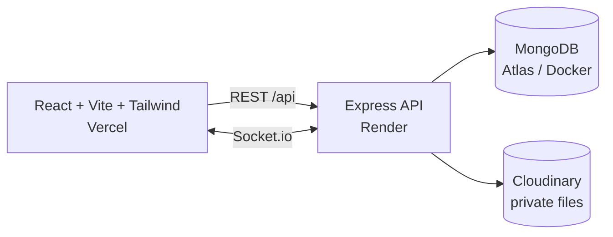

# StudyCircle

Private, admin-approved study groups for Indian exam aspirants (JEE, NEET, UPSC, GATE, CA, Boards): shared notes, real-time chat with @mentions, and live notifications, all in one place.

**Live demo:** _add your Vercel URL here_. Click **Try the demo account** on the login page to explore as a group admin with chat, notes and join requests already waiting.

## What it does (V1)

- **Accounts:** sign up with a Gmail address and an Indian mobile number (+91, 10 digits). Passwords are bcrypt-hashed and sessions use 7-day JWTs.
- **Privacy by default:** other users only ever see your name and avatar. Email and mobile are excluded from every query (`select: false`) and are covered by an automated privacy test over all API and socket payloads.
- **Groups:** Open, Approval and Invite-only modes, 6-character invite codes and links, and membership in many groups at once. The sidebar shows unread counts and @mention badges per group.
- **Join requests:** a requester sends an optional note, and the admin sees it live and approves or rejects it. Approved users get access without a page reload. After a rejection, a user can ask again in 7 days.
- **Real-time chat (Socket.io):**
  - optimistic send with retry
  - @mention picker with keyboard support; `@everyone` is admin-only
  - typing indicator and history loaded as you scroll up
  - mention notifications that open the group at the highlighted message
  - admin message removal
- **Notes:** upload PDF/PNG/JPG/DOCX up to 10 MB, **explanation videos** (MP4/WebM/MOV) up to 100 MB, or write Markdown. Types are checked from the file bytes on the server. Notes are organised by folder and tag, searchable, and viewable in the app; videos stream with seeking. Files go only to group members, and videos use a 15-minute personal link.
- **Who can delete a note:** the person who uploaded it, the group admin, or the platform **superadmin**. The superadmin can open any group read-only to moderate it.
- **Notifications:** a bell with an unread count, pushed live to every open tab.
- **Roles:** each group has exactly one **admin** (approves requests, removes members, deletes any message or note, edits settings, transfers admin). Everyone else is a **member**.

## Architecture



- **One repo, two apps:** `client/` (deployed to Vercel) and `server/` (deployed to Render). Vercel's serverless functions can't keep WebSocket connections open, so the Socket.io server runs on Render.
- **Server layout:** `models`, `routes`, `controllers`, `middleware`, `services`, `sockets`, `validators`. Every permission is checked on the server by shared middleware (`auth`, `requireGroupRole`), for REST and socket events alike.
- **Live access control:** when a member is approved or removed, the server joins or removes all of that user's open sockets to or from the group's room, so access changes instantly.
- **Security:**
  - helmet and a CORS allow-list
  - rate limits (10 auth attempts per 15 min per IP)
  - zod validation on every input
  - chat and Markdown rendered without raw HTML
  - redirect targets checked against open-redirect tricks
- **Data:** 7 collections. Messages, memberships and join requests live in their own collections, never in arrays inside a group document. A partial unique index enforces one *pending* request per user per group while still allowing repeat requests over time.

The full requirements specification (SRS) is in [docs/](docs/).

## Run it locally (Docker)

Requires Docker Desktop (or Docker Engine with Compose).

```bash
docker compose up --build                     # MongoDB + API + web, with live reload
docker compose exec server npm run seed       # demo users, groups, chat and notes
```

Open http://localhost:5173 and use **Try the demo account** (`demo.ananya@gmail.com` / `studycircle`).

To also create a platform superadmin, seed with:

```bash
docker compose exec -e SEED_SUPERADMIN_EMAIL=you@gmail.com -e SEED_SUPERADMIN_PASSWORD='a-long-password' server npm run seed -- --reset
```

If ports 27017, 5000 or 5173 are taken, create a `.env` next to `docker-compose.yml`:

```bash
MONGO_PORT=27019
SERVER_PORT=5050
CLIENT_PORT=5175
```

Without `CLOUDINARY_URL`, uploads are stored in a Docker volume.

### Tests

```bash
docker compose up -d mongo
cd server && npm install
MONGO_URL=mongodb://localhost:27017/studycircle_test npm test
```

The API suite follows the SRS acceptance checks:
- role checks return 403
- no email or mobile leaks to other users
- the join flow works live
- a second rejection works, and removed members lose access at once
- unread and mention counts work across 3 groups
- a 10 MB PDF uploads, while 11 MB and `.exe` files are refused
- videos up to 100 MB upload and stream with byte ranges
- notes can be deleted by the uploader, the group admin and the superadmin, but not by other members

## Deploy for free

1. **MongoDB Atlas:** create a free M0 cluster, add a database user, allow access from anywhere (`0.0.0.0/0`), and copy the connection string.
2. **Cloudinary:** create a free account and copy the `CLOUDINARY_URL` from the dashboard.
3. **Render (API):** go to New → Blueprint and pick this repo. `render.yaml` sets up the service. Fill in `MONGO_URL`, `CLOUDINARY_URL` and `CLIENT_ORIGIN` (your Vercel URL from step 4). Render generates `JWT_SECRET` for you.
4. **Vercel (web):** import the repo, set **Root Directory** to `client`, and add the environment variable `VITE_API_URL` = your Render URL (e.g. `https://studycircle-api.onrender.com`). Deploy, then put the Vercel URL into Render's `CLIENT_ORIGIN`.
5. **Demo data:** from your machine, run `cd server && MONGO_URL="<atlas url>" npm run seed`. To restore the demo later, run it again with `-- --reset`.

The shared demo accounts can't delete groups or change their mobile number, so the live demo stays intact.

## Known limits

- Render's free tier sleeps after 15 minutes idle; the first request after that takes about 30 seconds.
- Mobile numbers are not verified by SMS OTP yet (planned, FR-AUTH-11).

## Roadmap

- **V2:** video calls for up to 5 people (WebRTC mesh), public group reviews with superadmin moderation, the superadmin panel, a shared Pomodoro timer, AI note summaries and @StudyBot (Claude).
- **V3:** answers from a group's notes with citations (RAG), quizzes, Google sign-in, streaks.
